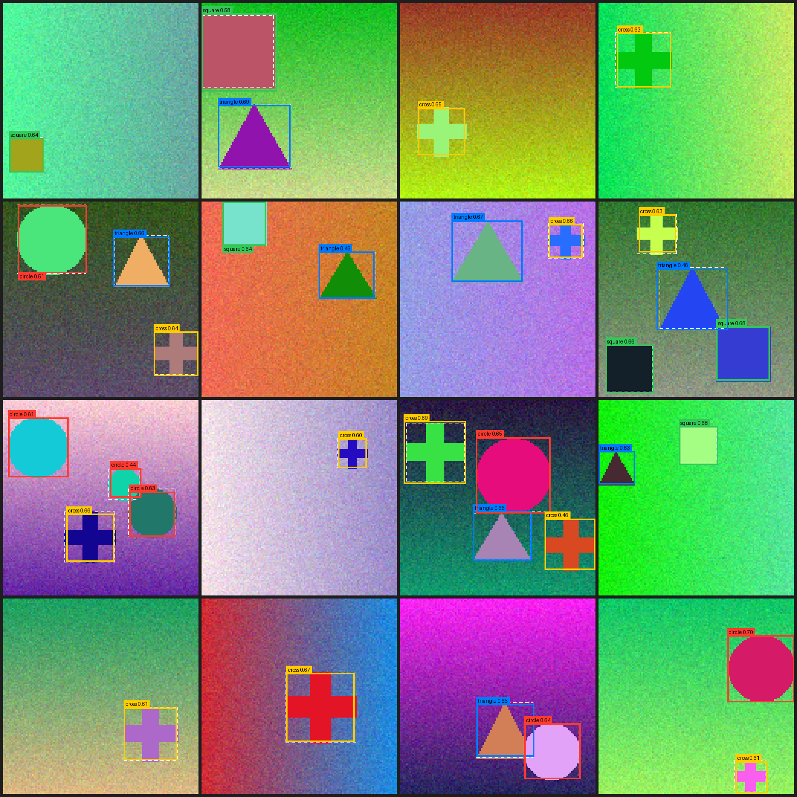

# Mini-YOLO：从零实现的 YOLOv1 目标检测

一个用 PyTorch 从零手写的 YOLOv1 风格目标检测器。除了 PyTorch 本身，IoU、NMS、损失函数和 mAP 评估全都是自己写的，不依赖 torchvision，也不需要下载任何数据集。

它在自动生成的"几何图形"数据集上训练，学会找出图里的 **圆形 / 正方形 / 三角形 / 十字**。CPU 上几分钟就能训完。



> 实线框是模型的预测（类别 + 分数），白色虚线框是真实标注。

## 快速开始

```bash
pip install -r requirements.txt

python train.py            # 训练，权重保存到 weights/miniyolo.pt
python detect.py --show-gt # 在新生成的图片上检测，结果输出到 outputs/demo.png
python -m pytest tests     # 跑单元测试
```

仓库里已经带了一份训练好的权重 `weights/miniyolo.pt`，可以直接运行 `detect.py`。

## 结果

默认配置（5000 张训练图，40 轮，宽度 16，约 50 万参数），在 4 核 CPU 上约 22 分钟训练完。
下面是在 1000 张训练时从未见过的测试图上的结果：

| 指标 | 数值 |
|---|---|
| mAP@0.5 | 1.000 |
| mAP@0.75 | 0.989 |
| mAP@0.5:0.95（COCO 口径） | 0.828 |
| 权重文件大小 | 2.0 MB |
| CPU 推理延迟（单张） | 约 4.5 ms |

mAP@0.5 在第 5 轮就到了 0.999：这些合成图形干净、对比度高，对这个任务来说不难。
更能说明定位精度的是 mAP@0.75 和 mAP@0.5:0.95，后面的训练轮次主要在提高框的精度。

预测分数大多在 0.6 左右，并不代表模型"没把握"。按 YOLOv1 论文的做法，置信度的训练目标是预测框和真实框的 IoU，而不是 1，所以分数反映的是框得有多准。

## 代码结构

```
miniyolo/
  data.py    合成数据集：随机背景 + 随机图形，以及把标注编码成 S×S 网格
  model.py   网络结构（Conv-BN-LeakyReLU 骨干网 + 1×1 卷积检测头）和输出解码
  loss.py    YOLOv1 损失（坐标 / 置信度 / 无物体 / 分类）
  utils.py   IoU、NMS、按类别 NMS、检测结果解码、mAP@0.5
train.py     训练脚本（AdamW + warmup + 余弦退火，每 5 轮评估一次 mAP）
detect.py    推理并画框，也可以检测自己的图片：python detect.py --images xxx.png
tests/       单元测试
```

## YOLO 是怎么工作的

1. **把图片切成网格。** 128×128 的输入经过 4 次下采样，变成 8×8 的特征图，每个格子对应原图 16×16 的区域。
2. **每个格子负责一个物体。** 物体的中心落在哪个格子里，就由哪个格子来预测它。
3. **每个格子输出 `B×5 + C` 个数。**
   - B 个候选框（默认 B=2），每个框是 `(x, y, √w, √h, conf)`：
     - `x, y` 是框中心相对所在格子左上角的偏移（0~1）
     - `√w, √h` 是框宽高（相对整张图）的平方根。用平方根是为了让小框上的误差更"值钱"
     - `conf` 是"这里有物体，并且框得准"的置信度
   - C 个类别分数（这里 C=4）
4. **训练时选"负责"框。** 一个格子的 B 个框里，和真实框 IoU 最大的那个负责回归这个物体，其余框被当成背景。
5. **推理时打分并去重。** 每个框的分数是 `conf × 类别概率`，过滤掉低分框后，再按类别做 NMS 去掉重叠的框。

### 损失函数

$$
\begin{aligned}
L =\; & \lambda_{coord} \sum_{obj} \left[(x-\hat x)^2 + (y-\hat y)^2 + (\sqrt w-\sqrt{\hat w})^2 + (\sqrt h-\sqrt{\hat h})^2\right] \\
 +\; & \sum_{obj} (C - \mathrm{IoU})^2 \;+\; \lambda_{noobj} \sum_{noobj} C^2 \;+\; \sum_{obj} \mathrm{CE}(p, \hat p)
\end{aligned}
$$

其中 λ_coord = 5，λ_noobj = 0.5，和原论文一致。

## 和原版 YOLOv1 的区别

| | 原版 YOLOv1 | Mini-YOLO |
|---|---|---|
| 输入 | 448×448 | 128×128 |
| 网格 | 7×7 | 8×8 |
| 骨干网 | 24 层卷积，ImageNet 预训练 | 10 层卷积 + BatchNorm，从头训练，约 50 万参数 |
| 检测头 | 两层全连接 | 1×1 卷积（全卷积） |
| 分类损失 | MSE | 交叉熵 |
| 优化器 | SGD + momentum | AdamW + warmup + 余弦退火 |

**继承下来的局限：** 每个格子只能预测一个类别，所以两个物体的中心落在同一个格子里时，只能检测出一个。数据生成器有意避开了这种情况。后来的 YOLOv2/v3 引入 anchor 和多尺度预测，就是为了解决这个问题。

## 可以继续玩的方向

- 加入 anchor box（YOLOv2），允许一个格子检测多个物体
- 多尺度检测头（YOLOv3 / FPN），提升小物体的检测效果
- 换成真实数据集，例如 Pascal VOC
- 导出 ONNX，在浏览器里实时跑
